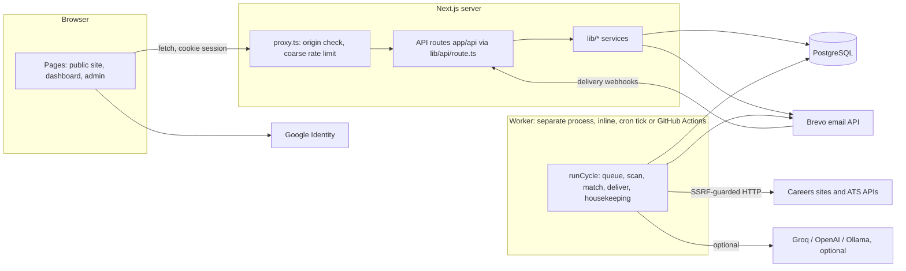

# Architecture

JobPingly is one Next.js application plus a background worker that share a PostgreSQL database. There is no other required infrastructure: the database is also the job queue, the settings store and the audit log.



## Request path

1. **`proxy.ts`** (Next.js 16's middleware) runs for every `/api/*` request. It rejects state-changing requests whose `Origin`/`Sec-Fetch-Site` shows they came from another site (CSRF protection for cookie sessions; cron, webhooks and one-click unsubscribe are exempt because a secret or signed token authorises them) and applies a coarse per-IP limit.
2. **`lib/api/route.ts`** wraps every handler: it resolves the session, enforces the required permission, validates query/body/params with zod, applies per-route rate limits, caps the body size and converts errors into one JSON envelope (`{ data, meta }` or `{ error: { code, message, details } }`).
3. **Services in `lib/`** hold the logic (watchlists, companies, jobs, tracker, users, admin). Routes stay thin.
4. **Data access** uses Drizzle for ordinary queries and postgres.js tagged templates for heavier SQL (all values are bound parameters). `prepare: false` keeps it compatible with Supabase's transaction pooler.

Pages are React Server Components for layout and access control (`requireServerUser`, `requireServerStaff`) and client components for interactive views, which fetch from the API with SWR (`lib/client/use-api.ts`). Public pages (home, pricing, directory) render on the server and are cached where the data allows.

## Identity and access

- **Sessions** are opaque 256-bit random tokens in an `httpOnly`, `SameSite=Lax` cookie (`Secure` in production). Only a SHA-256 hash is stored (`refresh_tokens`). Sessions slide to 30 days of inactivity, can be listed and revoked by the user, and are revoked on password change or suspension. A 15-second in-process cache avoids a database read on every request.
- **Sign-up** sends a 6-digit code; the browser holds a short-lived ticket, so the code alone is useless. Passwords are hashed with bcrypt and checked against a list of common passwords.
- **Google sign-in** verifies the ID token signature against Google's published keys (`jose`), and links to an existing account only for a verified matching email.
- **Roles** (`lib/auth/rbac.ts`): user, support, moderator, admin, owner, each an explicit set of permissions. Staff can only act on accounts ranked below them; only owners change roles or the sensitive switches (sign-up, sign-in, maintenance mode, the email kill-switch). The address in `ADMIN_BOOTSTRAP_EMAIL` is always an owner.
- **Audit log** (`lib/audit.ts`): every administrative and security-relevant action is appended to `admin_audit_log` with the actor, target, metadata, IP and user agent. Nothing updates or deletes these rows.

## Monitoring engine (`lib/monitoring`)

```
due sources --> monitor_tasks (queue) --> claim (FOR UPDATE SKIP LOCKED, 10-minute lease)
   --> extract (adapter -> structured data/HTML -> optional AI) --> normalise
   --> diff against stored jobs --> persist in one transaction --> match & notify --> next check
```

- **Queue** (`queue.ts`): a PostgreSQL table with a partial unique index allowing one active task per source, leases that return crashed work to the queue, priorities for manual scans, retry and cancel. Any number of workers can run; the queue arbitrates.
- **HTTP client** (`http.ts`): every request goes through the SSRF guard (URL rules, DNS check on every redirect hop and an address check at socket level), with timeouts, a 5 MB response cap, at most 5 redirects, per-host concurrency and spacing, and a descriptive user agent. `robots.txt` is honoured unless an admin turns that off.
- **Extraction** (`extract.ts`, `adapters/`): the URL is matched to an ATS adapter (Greenhouse, Lever, Ashby, Workday, SmartRecruiters, Recruitee, Workable, BambooHR, Personio, Pinpoint); otherwise the HTML adapter tries schema.org JobPosting data, embedded job APIs and job-link patterns; AI extraction is the last resort and can be disabled.
- **Identity and change detection** (`fingerprint.ts`, `differ.ts`): jobs are keyed by ATS id, canonical URL, or title plus location, compatible with v1's hashes so existing jobs keep their identity. Changes to tracked fields are recorded as events (`job_events`).
- **Safety rules** (`pipeline.ts`): a job closes only after 2 (API) or 3 (HTML/AI) consecutive misses; a sudden mass disappearance is treated as suspicious until seen 3 times; a failure is always recorded as a failure, classified (`errors.ts`), and backed off exponentially (30 minutes to 24 hours); sources that keep failing are marked degraded, then broken, and are paused after a configurable number of failures.
- **Scheduler** (`scheduler.ts`): one cycle records a heartbeat, refuses to run against an out-of-date schema, recovers expired leases, queues due sources, runs tasks with bounded concurrency, delivers due alerts, sends reminders and runs daily housekeeping (retention). The same cycle backs the long-running worker, `npm run worker:once`, `POST /api/cron/tick` and the scheduled GitHub Action.

## Matching (`lib/matching`)

Alert rules are stored per user and watchlist (`list_subscriptions.match_rules`): groups of keywords (a job must match one keyword from every group), exclusions (title only), the fields to search, whole-word matching, workplace/employment/level/location filters and whether jobs that do not state those details count. `engine.ts` evaluates a job and returns the reasons it matched. Matches are stored in `job_matches`, recomputed when rules change or a company is added, so the "Matching" view and the live preview always agree with what triggers alerts.

## Alerts and email (`lib/notifications`, `lib/email`)

- New matching jobs create `notification_queue` rows and a summarised in-app notification. Jobs present at a company's first scan are recorded silently (they are not new).
- The digest processor (`processor.ts`) groups each user's pending items by schedule (per-list override, account preference, or a platform-enforced schedule), respects the daily provider quota with a buffer for sign-in emails, staggers large audiences into cohorts, holds mail for recipients awaiting approval, and settles a row only after the provider accepted the email. Failed sends are retried with backoff.
- Without a configured provider in production, nothing is reported as sent: alerts stay queued.
- Unsubscribe links carry an HMAC-signed token (`APP_SECRET`); the page asks for confirmation (link scanners cannot unsubscribe anyone) and mailbox providers can use RFC 8058 one-click. Brevo webhooks report bounces and complaints, which switch alerts off for that address.

## Settings and feature switches (`lib/settings`)

A typed registry declares every platform setting with its type, default, validation, category and the permission needed to change it. Values live in `feature_flags`, are cached for 30 seconds per process and are edited from Admin > Settings.

## Running modes

| Mode | How | Use when |
| --- | --- | --- |
| `WORKER_MODE=separate` (default) | `npm start` runs the web server and the worker as two child processes | One always-on instance |
| `WORKER_MODE=inline` | The worker loop runs inside the web server (`instrumentation-node.ts`) | Memory is tight |
| `WORKER_MODE=off` | Web server only | The worker runs elsewhere, or cycles are driven by `/api/cron/tick` or the scheduled GitHub Action |

All modes can be combined safely because the queue is the only coordination point.

## Notable decisions

- **PostgreSQL as the queue** instead of Redis or a hosted queue: no extra service to pay for or operate, transactional with the data it changes, and fast enough at this scale (`SKIP LOCKED` claims, partial unique index for de-duplication).
- **Opaque server-side sessions** instead of stateless JWTs: sessions can be listed and revoked immediately (password change, suspension), and nothing sensitive lives in the cookie.
- **Idempotent "ensure" migration for v2** (`drizzle/0003`): production had drifted from the original migration history, so v2's schema migration checks before it creates or alters anything and can run on both the existing database and an empty one.
- **No hard dependency on paid services**: email, AI extraction and shared rate limits are optional; without them the app degrades visibly (console email in development, queued alerts in production, per-process limits).
